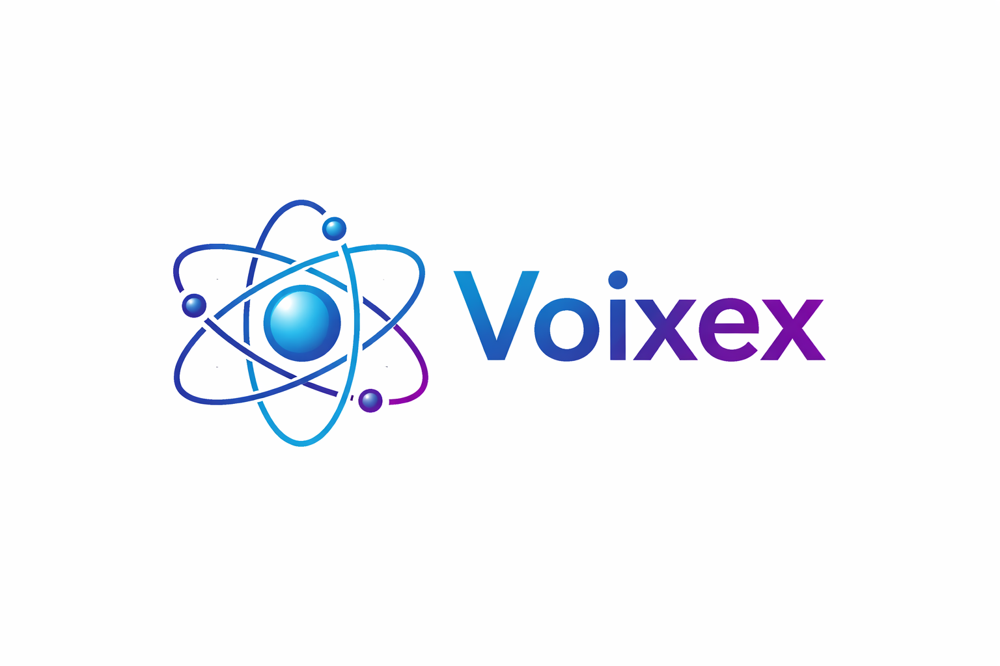

# Voixex

<p align="center">
  <strong>Voixex</strong> — self-hosted voice, screen sharing and text chat for your own closed server.<br/>
  One app for <strong>Windows</strong>, <strong>macOS</strong>, <strong>Linux</strong> and <strong>Android</strong>; the server is a single <strong>Docker</strong> image.
</p>

<p align="center">
  
</p>

<p align="center">
  <a href="https://github.com/kyratin/voixex/releases/latest"><strong>Download the latest release</strong></a> ·
  <a href="https://hub.docker.com/r/kyratinkokko/voixex"><strong>Server image on Docker Hub</strong></a> ·
  MIT license
</p>

---

## Branches

| Branch | What it is | Runs on | How you get it |
|--------|------------|---------|----------------|
| **`client`** (this one, default) | The app: UI, desktop shell, Android app, voice engine | Windows · macOS · Linux · Android | [GitHub Releases](https://github.com/kyratin/voixex/releases) (`.exe`, `.dmg`, `.apk`) |
| **[`server`](https://github.com/kyratin/voixex/tree/server)** | 🐳 Backend **Docker image**: API, voice mixer, built-in LiveKit SFU, SQLite | Any Docker host / Kubernetes (linux/amd64) | `docker pull kyratinkokko/voixex` |

There are no per-OS branches: one codebase builds every platform. The former `windows`, `linux`, `macos`, `server-auth` and `server-livekit` branches are kept as tags `archive/<name>`.

---

## Download

Every `v*` tag publishes a [release](https://github.com/kyratin/voixex/releases/latest) built by CI:

| System | File | Notes |
|--------|------|-------|
| **Windows** 10/11 x64 | `Voixex-<version>-win-x64.exe` | NSIS installer. SmartScreen may warn about an unknown publisher → *More info* → *Run anyway*. |
| **macOS** (Apple Silicon) | `Voixex-<version>-mac-arm64.dmg` | Not notarized. On first launch: *System Settings → Privacy & Security → Open Anyway*, or `xattr -dr com.apple.quarantine /Applications/Voixex.app`. |
| **Android** 7.0+ (arm64 / armv7) | `Voixex-<version>-android.apk` | Allow installing from this source. Phone screen sharing needs a server ≥ 0.6.2. |
| **Linux** x64 | build locally (below) | AppImage and `.deb` from `npm run dist:linux`. |

The app version is `version` in [`desktop-client/package.json`](desktop-client/package.json); the Android `versionCode` is derived from it.

---

## How it works

- **One server at a time, closed by default.** Nothing is visible until you join. Switching to another server disconnects from the current one.
- **Per-server identity.** On first join you enter the server password, pick a nick and a protection level:
  1 — password · 2 — device certificate · 3 — password + certificate. Certificates (`.voixexkey`) can be exported to another device and are listed in the app's certificate storage. The admin can require a minimum level.
- **Voice** — Opus over UDP, TCP or WebSocket with jitter buffer, redundancy and packet-loss concealment; or WebRTC through the server's built-in LiveKit.
- **AI noise suppression** (RNNoise, on by default) plus manual DSP: Speex, gate, echo cancellation.
- **Screen sharing** — WebRTC (H.264, simulcast) with stream sound; viewers choose quality like on Twitch; motion / detail modes. Phones share their screen natively.
- **Text channels** with attachments, member list (online and offline), roles (admins can promote others), speaking rings that follow voice volume.
- UI in English, Russian, Spanish and Portuguese.

---

## Repository layout

| Path | Description |
|------|-------------|
| [`primer_front/`](primer_front) | Next.js UI (static export) shared by all platforms |
| [`primer_front/android/`](primer_front/android) | Android app (Capacitor) with native plugins for calls and screen capture |
| [`desktop-client/`](desktop-client) | Electron shell for Windows / macOS / Linux, installers |
| [`voice-client/`](voice-client) | Desktop voice engine (UDP/TCP, Opus) |
| [`.github/workflows/release.yml`](.github/workflows/release.yml) | CI: APK check on push, full release on tag |

---

## Building

Requirements: **Node.js 22**, npm. Android additionally needs **JDK 21** and the Android SDK.

### Desktop — dev run (any OS)

```bash
(cd primer_front && npm ci)
(cd voice-client && npm ci && npm run build)
cd desktop-client && npm ci && npm run build && npm start
```

### Desktop — installers

Run in [`desktop-client/`](desktop-client); output goes to `desktop-client/release/`.

| Command | Result | Build on |
|---------|--------|----------|
| `npm run dist:win` | Windows NSIS `.exe` | Windows (or Docker below) |
| `npm run dist:mac` | macOS `.dmg` (ad-hoc signed) | macOS |
| `npm run dist:linux` | Linux AppImage + `.deb` | Linux (or Docker below) |
| `npm run dist:docker` | Windows + Linux + macOS zip | Any host with Docker (`electronuserland/builder:wine`) |

### Android

```bash
cd primer_front
npm ci && npm run build          # static UI into out/
npx cap sync android
cd android && ./gradlew assembleDebug    # or assembleRelease with your signing key
```

The APK lands in `primer_front/android/app/build/outputs/apk/`. Release signing in CI uses the secrets `ANDROID_KEYSTORE_BASE64`, `ANDROID_KEYSTORE_PASSWORD`, `ANDROID_KEY_ALIAS`, `ANDROID_KEY_PASSWORD`.

### Release

```bash
# bump desktop-client/package.json "version", commit to client, then:
git tag v0.6.12 && git push origin client v0.6.12
```

CI builds the APK, the Windows installer and the macOS DMG and attaches them to the GitHub release.

---

## Server

The backend lives on the **[`server`](https://github.com/kyratin/voixex/tree/server)** branch and ships as the Docker image **`kyratinkokko/voixex`**:

```bash
docker run -d --name voixex \
  -p 18080:8080 -p 50000:50000/udp -p 50000:50000/tcp \
  -p 7880:7880 -p 7881:7881/tcp -p 7882:7882/udp \
  -e TOKEN_SECRET=<long-random> -e SUPERUSER_PASSWORD=<password> \
  -e PUBLIC_UDP_HOST=<your-host> -e LIVEKIT_NODE_IP=<public-ip> \
  -e DB_PATH=/data/voip.sqlite -v voixex-data:/data \
  kyratinkokko/voixex:latest
```

`DB_PATH=/data/voip.sqlite` keeps the database on the volume (the image default is inside the container and is lost when it is recreated). Then add the server in the app by `<your-host>:18080`. HTTPS, LiveKit and Kubernetes notes are in the server branch README.

---

## Troubleshooting

| Problem | What to check |
|---------|---------------|
| macOS says the app is damaged / can't be verified | See the macOS note in [Download](#download). |
| Nobody hears you / you hear nobody | Firewall: TCP API port and UDP/TCP `50000`; `PUBLIC_UDP_HOST` on the server. Try another voice transport in settings. |
| Stream doesn't start or stays black | Ports `7880`, `7881/tcp`, `7882/udp`; `LIVEKIT_NODE_IP` and `LIVEKIT_PUBLIC_URL` (`wss://` behind HTTPS). |
| Empty microphone list | OS microphone permission, then restart the app. |
| Phone screen sharing says the server is too old | Update the server image to 0.6.2 or newer. |

---

## License

MIT — see [LICENSE](LICENSE).
