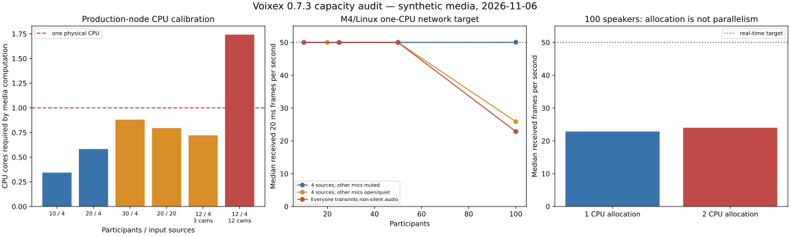
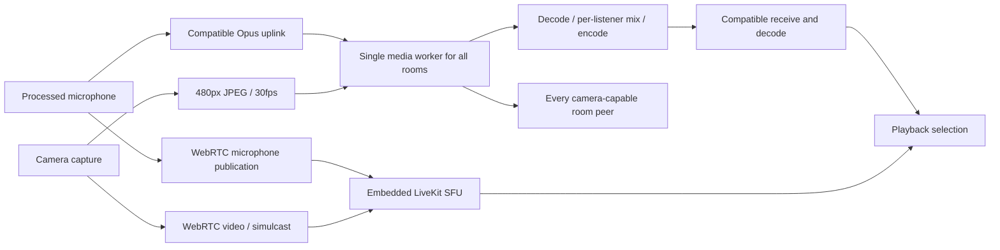

# Voixex capacity and architecture audit — 2026-11-06

## Decision

The current deployment should **not be advertised as supporting 50–100 active conference participants without audio degradation**. The measured limits depend heavily on microphone state, active speakers, cameras, and the selected media path.

For the existing **one-CPU Xeon Gold 6254 node**, use **10–15 participants, 2–4 talking, no cameras** as a conservative initial operating target with headroom. Treat 20 as conditional and 30 as a poor promise of consistent quality. This is an engineering estimate from measured CPU cost and the deployment's shared CPU budget, **not a completed production end-to-end concurrency certification**. Camera-heavy calls require a separate budget; twelve simultaneously published compatibility cameras already exceed one CPU in the production-node computation test, before SFU/API work.

The problem is both software and hardware. One small CPU exposes the limits early, while a single mixer, unnecessary silence processing, duplicated media paths, and unrestricted fan-out prevent efficient scaling. Doubling the local container's CPU allocation did not restore real-time processing for 100 simultaneous speakers.

No application fixes or new client/server release were made as part of this audit. Production deployment settings, databases, and image tags were not changed.

## 1. What was tested

- **24 media scenarios**, seven k6 API scenarios, and four valid LiveKit scenarios. Raw measurements, summaries, CPU calibration results, and a synthetic PCM sample are included in [data/](data/).
- Application client revision: `b9a64072dd14bea93e68e0bef53c96321bfe202b` (0.7.5).
- Production server revision: `ef4883342919376b7888b0d0481afc1f497b9223` (0.7.3).
- Image: `kyratinkokko/voixex:0.7.3`, multiarch index `sha256:cd37a983383ca786e8bb4e71f9343f680f4c3d69a9843cec53db4b421f1a9aaa`.
- Local network load tests: native Linux ARM64 containers on Apple M4, Docker Desktop VM with 10 CPUs and approximately 7.65 GiB RAM. Target media container limited to **one CPU / 1536 MiB**; generator isolated in another container, normally with four CPUs / 2 GiB. Explicit two-CPU trials are named accordingly.
- UDP, length-prefixed TCP, and WebSocket use the real production media worker, AES-GCM protocol, Opus codec adapter, receive jitter buffers, mixing, per-recipient encoding, and transport handling. The harness does **not** run the complete HTTP application, SQLite presence hooks, or embedded LiveKit inside that same media CPU allocation.
- Normally 20 measured seconds after five or eight warm-up seconds. One 120-second soak includes the actual desktop `VoiceEngine` receiver.
- 48 kHz mono, 960 samples / 20 ms, primary Opus uplink packets and a probe once per second. Primary-only uplink matches the web voice encoder; desktop UDP's additional uplink redundancy was not simulated for every synthetic sender. Server downlink redundancy remains enabled as in production. Thus this is not a worst-case redundant-packet bandwidth estimate.
- Synthetic periodic signals, including a 500 Hz marker. These are not recorded speech, MOS/PESQ measurements, or a comprehensive codec-quality study.
- Camera relay tests: 10,000-byte payloads fragmented into twelve packets, 30 fps per publisher, UUID-length room and client identifiers. Receivers verify/decrypt packets. The payload tests relay work, not JPEG decoding, camera capture, or UI rendering. Publishers are phase-aligned, creating burstier traffic than independently started cameras.
- k6 2.3.0: authenticated metadata reads, SQLite chat inserts, and successful password logins. Chat writes use a separate Docker disk volume, not tmpfs or the production PVC. These cases do not include mass WebSocket chat/presence fan-out.
- LiveKit server 1.13.9 with CLI 2.19.3: actual WebRTC publisher/subscriber connections, valid sample media, single-layer high-resolution VP8 video. Publishers and subscribers are separate simulated identities; their counts must not be relabeled as the same number of full-duplex app users. The CLI consumes RTP, not a physical device's rendered sound/video.

### Guardrails and discarded pilots

Early macOS-to-Docker UDP published-port results showed multi-second forwarding delays at low server CPU. The same load through a Linux bridge immediately recovered 50 frames/s and approximately 1 ms probe RTT. Those forwarded-port pilot results are excluded; they do not establish a Kubernetes network fault.

An exploratory generator also scheduled probes/cameras too frequently. Its results are excluded. The final generator uses absolute deadlines, records sent counts, and checks that audio, probes, and cameras do not exceed their configured rates. An initial LiveKit 25-source run selected only 16 tracks under a 4×4 layout; it was replaced with a complete 25-track 5×5 run. CPU sampling was also corrected to strip Docker terminal escape sequences.

Final main and open-microphone audio trials have zero generator skipped ticks. The 1000-muted-session run skipped 26 scheduling ticks across 50 generator workers, but all 1000 HELLOs succeeded and no continuous audio was offered; it is only an idle-session check.

## 2. Deployment facts

Read-only inspection found two Kubernetes worker nodes with **one allocatable CPU each** and about 2.84 GiB RAM. Voixex runs as **one replica on worker-1**, using `Recreate`, one PVC, and server 0.7.3. Requests are 400m CPU / 384 MiB RAM; the memory limit is 1536 MiB. There is **no container CPU limit**: 400m is a request, not a 0.4-CPU cap. The physical node still has only one CPU shared with other workloads.

The production pod reports Xeon Gold 6254 @ 3.10 GHz. Worker-2 reports a different processor, Xeon E-2278G @ 3.40 GHz. Their measurements are kept separate.

Observed node CPU before testing was roughly 21–22% on worker-1 and 14–17% on worker-2; those are snapshots, not reserved spare capacity. Existing pod usage was roughly 13m CPU / 117 MiB before load testing. Neither idle usage nor the cluster-wide sum of two CPUs indicates available mixer capacity.

### Production-node CPU calibration

A separate, ephemeral job ran the unchanged production core synchronously on worker-1, with a **200m CPU quota**, no production traffic, and no database/PVC mount. Another independent calibration ran on worker-2 with a 600m quota. Both namespaces and jobs were deleted after their results were collected.

The table uses **process CPU time**, normalized per 20 ms audio tick. It does **not** use throttled wall-clock durations as production latency, and it does not claim a live full-stack load test. It includes encryption, decoding, mixing, soft clipping, encoding, and camera relay; outgoing sends are counting callbacks rather than network sockets. It excludes real transport I/O, host/worker IPC, full API, and SFU overhead.

| Participants | Actual input sources | Compatibility cameras | CPU ms / 20 ms tick | CPU cores required for real time |
|---:|---:|---:|---:|---:|
| 10 | 4 | 0 | 6.87 | 0.34 |
| 20 | 4 | 0 | 11.66 | 0.58 |
| 30 | 4 | 0 | 17.62 | 0.88 |
| 20 | 20 | 0 | 15.89 | 0.79 |
| 12 | 4 | 3 | 14.44 | 0.72 |
| 12 | 4 | 12 | 34.85 | 1.74 |

For 30 listeners / 4 sources, 17.62 ms of CPU per tick leaves little of the 20 ms interval for everything else, even with an otherwise dedicated core. Twenty simultaneous sources consume approximately 0.79 CPU before full-stack overhead. Twelve compatibility cameras with twelve room members require approximately **1.74 CPU**, already impossible for the single mixer thread at real-time speed on this processor.

These are short synthetic CPU calibrations; turbo frequency, scheduling, signal content, and full-stack contention affect deployment performance. The proposed 10–15 operating target is deliberately below the arithmetic ceiling, and still requires representative device/network validation.

## 3. Network media results on the isolated M4/Linux target

`CPU %` is percent of one core. Output cadence should be approximately 50 frames/s. Marker latency measures source generation to decoded receive callback for sampled synthetic listeners; it excludes physical capture and speaker output and usually excludes the actual client receive jitter buffer. `PLC` is server concealed frames divided by successfully played plus concealed input frames, sampled from production five-second diagnostic snapshots. Snapshot edges are not exactly aligned with every scenario window.

`s4` means four non-silent sources. Unless `openmic` is in the name, other synthetic microphones are **muted**, not merely quiet. `all` means everyone transmits non-silent input.

| Scenario | CPU avg | Median receive frames/s | Server PLC | Marker p95, ms | Worst worker loop p99, ms |
|---|---:|---:|---:|---:|---:|
| udp-10-s4-1cpu | 26.8% | 50.00 | 0.000% | 69 | 12.1 |
| udp-25-s4-1cpu | 35.0% | 50.00 | 0.000% | 67 | 14.5 |
| udp-50-s4-1cpu | 49.8% | 50.00 | 0.000% | 58 | 15.7 |
| udp-100-s4-1cpu | 95.9% | 50.05 | 0.250% | 144 | 80.7 |
| udp-25-all-1cpu | 41.7% | 50.00 | 0.000% | 63 | 14.3 |
| udp-50-all-1cpu | 87.0% | 50.00 | 0.008% | 68 | 22.3 |
| udp-100-all-1cpu | 88.5% | 22.85 | 39.391% | 635 | 222.0 |
| openmic-20-s4 | 35.7% | 50.00 | 0.000% | 87 | 14.8 |
| openmic-50-s4 | 67.9% | 50.00 | 0.000% | 62 | 22.3 |
| openmic-100-s4 | 88.1% | 25.85 | 38.003% | 525 | 194.1 |
| openmic-100-silent | 88.0% | 27.25 | 37.164% | — | 187.0 |
| 2cpu-100-all | 88.5% | 24.00 | 39.386% | 770 | 209.8 |
| 2cpu-100-s4 | 94.5% | 49.90 | 1.000% | 161 | 40.6 |
| udp-100-10rooms-1cpu | 99.2% | 49.30 | 4.144% | 298 | 44.4 |

Key interpretation:

- 50 participants / four sources with the others muted was healthy on the faster local M4 core, at about 50% CPU. It is not evidence that the production Xeon can do the same.
- 100 participants / four sources with others muted consumed almost a complete local core. Even when average output still approximated 50 fps, burst delays and loop stalls removed operating headroom.
- With 100 open microphones and only four people speaking, output fell to about 26 fps and marker p95 exceeded 500 ms. Even **100 quiet open microphones** overloaded the processing path.
- Giving the container two CPUs left the 100-speaking case at about 24 fps: the same serial mixer cannot use both cores for its mixing/codec work.
- 100 participants in ten rooms, two active sources per room, still saturated the single global worker. More rooms do not create more workers.
- No production codec encode/decode errors or worker crashes were logged in the valid media scenarios. Overload still caused concealment and discarded frames; error-free decoding is not evidence of good sound.

### Silence is not the same as mute

One hundred muted sessions consumed about 3.5% CPU. One hundred quiet but unmuted sessions consumed about 88% and produced only about 27 fps of silence. The server adds any returned PCM frame to `sources`, even when its RMS is effectively silent, then mixes and encodes recipient streams.

The 1000-muted-session check accepted all 1000 HELLOs at about **5.9% CPU** and 170 MiB RSS. It had no continuous voice or video. It does not certify 1000 app users, API sessions, renderers, or simultaneous speakers.

### Transports: 50 members, four sources, other microphones muted

| Transport | CPU avg | Median frames/s | Probe RTT p95, ms | Marker p95, ms |
|---|---:|---:|---:|---:|
| udp | 49.8% | 50.00 | 1 | 58 |
| tcp | 51.1% | 50.00 | 6 | 66 |
| ws | 57.2% | 50.00 | 38 | 102 |
| mixed | 52.7% | 50.00 | 1 | 52 |

WebSocket adds a main-thread and structured-clone hop in each direction. TCP/WebSocket also share reliable byte queues with camera packets; loss can cause head-of-line blocking. These tests used a clean bridge network, not Wi-Fi loss, WAN congestion, TURN/TLS, or packet reordering across the internet.

### Cameras: 12 members, four sources

| Publishing cameras | CPU avg | Voice frames/s | Camera packets received in 20s |
|---:|---:|---:|---:|
| 3 | 32.4% | 50.00 | 237,600 |
| 6 | 39.3% | 50.00 | 475,200 |
| 12 | 51.7% | 50.00 | 950,400 |

The M4 target preserved voice in these camera cases; the production-node computation cost is much higher. A 10 KB frame at 30 fps is **2.4 Mbit/s per sender before framing**. Twelve cameras, each relayed to eleven other room members, create **316.8 Mbit/s of JPEG payload**. With Voixex framing/encryption, the calibration measured approximately **370 Mbit/s**, before IP/Ethernet overhead and separate LiveKit traffic.

With 100 members and twelve publishing cameras, the same payload formula becomes **2.85 Gbit/s** before framing. Actual node uplink limits were not measured. The twelve-tile UI limit is a presentation limit, not a media subscription or server fan-out limit.

## 4. Real client soak and the meaning of latency/pitch

Twenty participants, four non-silent sources, mostly open quiet microphones, and one actual desktop `VoiceEngine` receiver ran for **120 measured seconds**. The real receiver delivered **6000 frames / 50 fps**. Marker latency to its PCM callback was **94 ms median / 97 ms p95**. Its coarse spectral check selected **500 Hz for every measured marker frame**. The observer reported zero network loss and one concealed frame over the session including warm-up; server steady-state concealment was zero.

The exact-sample AudioWorklet checks were rerun: queued quiet tones preserve every sample; capture continues producing 20 ms frames without renderer message consumption; the microphone gate executes on the audio thread. The earlier real-browser 180 ms stall check is also part of the existing browser validation suite.

[Listen to five seconds of synthetic receiver PCM](data/synthetic-observer-5s.wav). This sample is **before UI speaker playout**, not a physical microphone-to-speaker recording.

The UI then configures a playback startup target of `140 + 2.5 × jitter`, clamped to **140–320 ms**, with maximum queued audio of roughly 0.9–1.6 seconds. Thus a healthy ~97 ms PCM callback delay does not mean 97 ms mouth-to-ear latency. Adding a stable 140 ms playout queue would put that path around **240 ms before additional capture/device/WAN effects**; this is an estimate from code and measurements, not a measured end-to-end percentile. WebRTC has its own buffering behavior.

Repeated/concealed frames and underrun/rebuffer cycles can sound robotic or like pitch instability. Those are distinct from resampling at a changing sample rate or the former Opus memory corruption bug. This study does **not** prove the physical Android complaint is eliminated. Mobile camera encoding, dual media paths, WebCodecs, crypto, JNI/base64 bridges, main-thread timers, thermal throttling, and Wi-Fi conditions remain relevant.

Harness RSS during the soak went from approximately 168 to 174 MiB. The harness retains diagnostic samples, unlike production logging. This neither establishes a production memory leak nor certifies stable memory over 24 hours.

## 5. k6 API results

One CPU, local Docker disk volume, 0.2-second per-VU think time, approximately 20 seconds per scenario. VUs represent concurrent request loops, not active conference users. The target is the actual HTTP application, with an otherwise idle media worker and no embedded SFU load.

| Operation | VUs | Requests/s | p95, ms | p99, ms | p95 < 200 ms target |
|---|---:|---:|---:|---:|---|
| read | 25 | 120.8 | 8.7 | 12.5 | pass |
| read | 100 | 484.3 | 9.8 | 13.4 | pass |
| read | 250 | 1209.8 | 13.2 | 24.2 | pass |
| write | 25 | 121.1 | 11.5 | 14.4 | pass |
| write | 100 | 484.1 | 14.9 | 24.9 | pass |
| login | 10 | 17.3 | 553.0 | 559.0 | p95 SLO exceeded |
| login | 25 | 17.8 | 1386.0 | 1387.5 | p95 SLO exceeded |

All checked business operations succeeded. A repeated bootstrap registration intentionally encountered an existing profile in later scenarios, contributing one expected setup HTTP error to their raw `http_req_failed` counters. The login cases exited 99 because of the latency threshold, not because successful logins failed.

The password-login rate plateaus around **17–18/s** on this local one-core target. `bcryptjs` performs CPU-heavy work on the JavaScript thread even through its asynchronous API. A login burst can delay API/control WebSockets and compete for the same physical CPU as the mixer. The benchmark used one test profile and an isolated database; it does not establish login capacity for a large real member table or network PVC.

Chat inserts reached roughly 484/s in the tested small database with no audience WebSockets. This is not a durable production-PVC or large-history chat throughput guarantee.

## 6. Standalone LiveKit results

One local CPU, no simultaneous Voixex mixer in this target container. CPU averages use a steady-state window, excluding most join/shutdown work. Samples were 720p-class high-resolution single-layer VP8 and do not exactly match Voixex camera bitrate/simulcast settings.

| Audio publishers | Video publishers | Subscribers | Steady CPU avg | Tracks received / expected | Aggregate RTP media rate | Reported packet loss |
|---:|---:|---:|---:|---|---|---|
| 25 | 0 | 25 | 61.7% | 625/625 | 12.1mbps (484.1kbps avg) | 0 (0%) |
| 4 | 0 | 50 | 37.4% | 200/200 | 3.8mbps (75.6kbps avg) | 0 (0%) |
| 4 | 1 | 50 | 42.0% | 250/250 | 102.8mbps (2.1mbps avg) | 0 (0%) |
| 4 | 12 | 12 | 37.1% | 192/192 | 283.7mbps (23.6mbps avg) | 0 (0%) |

All expected tracks were received, with zero reported RTP packet loss. These runs demonstrate SFU forwarding behavior, not decoded video performance or perceived audio quality on phones. The existing app additionally runs its compatibility mixer and camera relay, so these isolated SFU figures cannot be quoted as current full-app capacity or added to CPU calibrations from a different CPU as exact predictions.

## 7. Architectural findings and ownership

| Finding | Evidence | Main ownership | Priority |
|---|---|---|---|
| Silence is processed like an active input; recipient Opus streams continue unnecessarily | Open-mic quiet test versus mute test; `core.ts` pushes any non-null frame into sources | Code | P0 |
| One worker handles every room, decode, mix, encode and camera relay | One `new Worker` in `media.ts`; `mixTick` iterates every room | Code, amplified by one-CPU deployment | P0 |
| Per-listener mixing is O(N × S × 960) every 20ms; N encoders run for N recipients | Nested listener/source loops and `encoderFor(listener)` | Code | P0 |
| WebRTC does not remove the compatibility voice uplink/mix | UI sends PCM whenever not muted; drops received PCM only after the compatible receiver has processed it; WebRTC microphone is published separately | Code | P0 |
| Cameras are published through WebRTC and compatibility JPEG in parallel without per-viewer demand negotiation | Camera capture tick always produces JPEG; `publishCamera` runs alongside it | Code and bandwidth | P0 |
| Page/mini view visibility does not bound subscriptions | `autoSubscribe: true`, `adaptiveStream: false`; paging only slices React participants | Code, client CPU and network | P1 |
| Successful password bursts block the API event loop and compete with audio for CPU | k6 login plateau; `bcryptjs` on API thread | Code and CPU | P1 |
| Voice, cameras and control share reliable queues; WS bridge IPC has no bounded in-flight admission | Camera/voice use same transport; `postMessage`; WS worker backlog reports zero before main-thread filtering | Code/network | P1 |
| Main-thread fallback screen chunks are large JSON/base64 payloads | API `screen_chunk` and WebSocket fan-out; screen websocket cap accepts multi-MB messages | Code and client/server CPU | P1 |
| Broadcasts are server-wide with limited backpressure for ordinary events | `emitToServer` loops every socket, including voice level events | Code | P1 |
| Horizontal scaling is not implemented by changing replicas | In-memory sessions/rooms/WS state, one SQLite PVC, embedded SFU without distributed room coordination | Architecture/infrastructure | P1 |
| Large uploads are buffered before disk streaming | Upload handler collects chunks, max 50 MB per upload | Code and memory | P1 |
| Health endpoint does not verify audio deadlines or worker/SFU health | `/health` returns `ok: true` from the API | Observability | P1 |
| Unknown UDP endpoints can trigger key scans over active sessions | NAT rebinding fallback decrypts against other sessions before application rate limits | Code/hardening under load | P1 |
| Room/session caches and unvirtualized large member lists require longer churn/UI tests | Room maps persist; member list maps every member | Code; not proven leak in this study | P2 |

A byte limit is not a latency limit: 24 KiB at a roughly 5–8 KiB/s audio-only reliable stream can represent several seconds, while camera traffic fills it much faster. Old voice packets need age/deadline handling and priority, not only a shared byte threshold. The main-thread WS control exception also uses packet length (`<64`) rather than an explicit control classification; UUID-length encrypted probe replies exceed that size. This was identified statically, not separately reproduced under a slow-reader test.

### Current path

## 8. Recommended development sequence

### P0: remove work that does not improve the call

1. Introduce tested silence/VAD handling with hold/pre-roll and correct talkspurt timestamps. Skip silent mix contributions and avoid generating downlink silence when no audible source exists. Do not use an aggressive threshold that cuts quiet speech. Consider DTX only together with correct receiver gap handling; WebRTC mic publication currently explicitly disables DTX.
2. Negotiate one primary media path per participant. Avoid continuously generating, transmitting, mixing and decoding compatibility voice when it is not needed. Keep a tested fallback transition, not two permanently active media systems.
3. Publish JPEG compatibility cameras only when a recipient actually needs that representation. Track viewing interest across the main stage, mini window and pop-out; unsubscribe/pause hidden remote tracks, choose appropriate layers, and enforce a real subscription cap rather than only twelve visible React tiles.
4. For the default gain case, compute room sums once and subtract each speaker's own contribution. Apply sparse gain corrections for custom per-peer volume. Share encoded mixes among listeners that truly need identical output, maintaining safe talkspurt/codec state semantics. Alternatively, use an SFU voice architecture and keep mixing only for explicit legacy bridge participants.

### P1: make scaling and overload explicit

5. Partition rooms over a bounded worker pool or independent media services, with explicit room ownership and routing. All rooms currently share the same worker. Moving only the API to more replicas will not solve that.
6. Separate SFU lifecycle/resources from API and legacy mixing. A 2–4 CPU deployment provides useful independent scheduling capacity for API, SFU and media, but does not make the current single mixer use four cores. Horizontal deployment requires shared control state / room placement; do not simply clone the current SQLite-PVC pod.
7. Put password hashing behind a bounded worker pool, admission/rate limits, and measured queues. Stream uploads to disk with global concurrency and byte limits instead of accumulating every body in memory.
8. Add per-stream pacing, bounded IPC queues, voice priority over compatibility video, and maximum audio packet age. Define which stale work is discarded when a 20 ms deadline is missed instead of relying on catch-up bursts.
9. Export per-worker tick duration/missed deadlines, concealment, drops, codec failures, in-flight IPC, queue age, camera egress, and per-core CPU. Alert on those metrics and a synthetic audio canary, not only process liveness or average pod CPU.

### P2: validate improvements, then choose capacity

10. Repeat these benchmarks with each meaningful optimization. Complexity 8 → 5 reduced encode CPU by about 42% on one synthetic local codec microbenchmark, but is not a proven whole-call improvement or a perceptual-quality recommendation. A native Opus/media implementation is another hypothesis to benchmark, not an already measured speedup.
11. Run a dedicated preproduction full-stack test on production-like CPU, network and durable storage, with real browser/mobile clients, representative speech, loss/jitter, joins/leaves, camera on/off, pop-outs, all transport combinations and a multi-hour soak. Include a weak Android device and thermal/battery measurements. Compare true microphone-to-speaker latency and objective audio quality.
12. Set separate supported limits for members, open microphones, simultaneous talkers, subscribed videos, camera publishers, screen viewers, login rate and egress. Introduce admission / quality reduction before queues and deadlines fail.

## 9. Source index and supporting references

Repository evidence:

- [Production mixer, camera relay, encoder and clock](https://github.com/kyratin/voixex/blob/ef4883342919376b7888b0d0481afc1f497b9223/backend/src/media/core.ts)
- [Single worker and WebSocket IPC bridge](https://github.com/kyratin/voixex/blob/ef4883342919376b7888b0d0481afc1f497b9223/backend/src/media.ts)
- [API, bcrypt, broadcasts and buffered upload handler](https://github.com/kyratin/voixex/blob/ef4883342919376b7888b0d0481afc1f497b9223/backend/src/index.ts)
- [Client media selection, compatible uplink and adaptive playout buffering](../../primer_front/app/page.tsx)
- [Camera capture and compatibility JPEG publication](../../primer_front/lib/camera/use-camera.ts)
- [LiveKit subscriptions, cameras and DTX settings](../../primer_front/lib/webrtc-media.ts)
- [Android native socket serialization](../../primer_front/lib/native-media-socket.ts)
- [AudioWorklet playback/capture](../../primer_front/lib/voice-playout.ts)

Primary documentation used to choose the methodology and interpret architecture:

- [LiveKit benchmarking](https://docs.livekit.io/transport/self-hosting/benchmark): use actual media load generation and budget generator resources separately.
- [LiveKit deployment](https://docs.livekit.io/transport/self-hosting/deployment/): CPU/bandwidth planning and distributed deployment considerations.
- [k6 supported protocols](https://grafana.com/docs/k6/latest/using-k6/protocols/): HTTP/API tests are separate from the custom UDP media generator.
- [Node.js worker threads](https://nodejs.org/api/worker_threads.html): CPU parallelism requires explicit partitioning among workers.

[Reproduction and tool notes](../../tools/performance/README.md) · [Environment](data/environment.json) · [Media CSV](data/media-summary.csv) · [Media JSON](data/media-summary.json) · [API results](data/api-summary.json) · [SFU results](data/livekit-summary.json)
